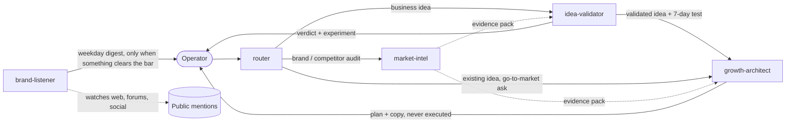

# gtm-agent-team

A multi-agent go-to-market team, specified as plain-text contracts you can run on any LLM agent framework.

Five agents, each with one job: a **router** that triages requests, an **idea validator** that kills weak ideas before they cost money, a **growth architect** that turns a validated idea into an executable acquisition system, a **market intel** analyst that audits a brand's public footprint with evidence, and a **brand listener** that watches for third-party mentions.

Patterns from the AI assistant team I run day to day.

---

## The problem

Most "AI for GTM" setups fail in one of three ways:

1. **One mega-prompt does everything.** The same agent brainstorms ideas, writes ad copy, researches competitors and sends emails. Output quality collapses to the average of all those jobs, and nobody can tell which part went wrong.
2. **Confident fiction.** CPCs, conversion rates, competitor ad spend and "industry benchmarks" appear with no source. A plan built on invented numbers is worse than no plan, because it looks finished.
3. **Silent side effects.** An agent with send, spend or publish permissions acts on its own reading of an ambiguous request. In GTM, that means a burned domain, a wasted budget or an email that cannot be unsent.

This repo is the opposite design: narrow agents, explicit hand-offs, evidence tags on every claim, and a human gate on every irreversible action.

## Team architecture



| Agent | One job | Never does |
|---|---|---|
| [router](agents/router/spec.md) | Understand the request and hand it to the agent that owns it | Deep specialist work, sending anything unasked |
| [idea-validator](agents/idea-validator/spec.md) | Generate and stress-test low-investment business ideas, end to end, down to a 7-day experiment | Building the product, contacting customers |
| [growth-architect](agents/growth-architect/spec.md) | Turn one given idea into a complete, executable acquisition system | Choosing the idea, launching campaigns, spending money |
| [market-intel](agents/market-intel/spec.md) | Audit a brand's public digital footprint and report findings with sources | Writing outreach or strategy, contacting the brand |
| [brand-listener](agents/brand-listener/spec.md) | Watch for third-party mentions and send a digest only when it matters | Replying, posting, engaging |

Full detail in [docs/architecture.md](docs/architecture.md).

## Design principles

The short version (long version in [docs/design-principles.md](docs/design-principles.md)):

- **One job per agent.** Stated in one sentence, at the top of the spec. If you need "and" twice, it is two agents.
- **Anti-jobs are written down.** Each spec lists what the agent refuses even when asked, and names who owns that work instead.
- **No leftover tools.** An agent gets only the tools its one job needs. The growth architect cannot send email because it has no reason to.
- **Evidence tags on every claim.** `[FACT]`, `[INFERENCE]`, `[ESTIMATE]`, `[ASSUMPTION]`. Unsourced numbers are ranges with a method, never point values.
- **Humans own irreversible actions.** Sending, spending, publishing, deleting: the agent drafts, the human executes.
- **Short chat, long artifact.** Deliverables go into a document; the chat gets the verdict, the first move and a link.
- **Silence is a valid output.** Agents that watch or report stay quiet when nothing clears the bar.

## Using the specs with any agent framework

Every `spec.md` is framework-agnostic. It works as a system prompt for a single model call, as an agent definition in a graph framework, or as a role in a crew-style orchestrator.

1. **System prompt.** Paste the spec's `Role`, `One job`, `Process`, `Output contract` and `Anti-jobs` sections into the agent's system prompt. Keep the evidence-tag section verbatim; it is what keeps the output honest.
2. **Tools.** Grant only what the spec's `Inputs` and `Process` require. Typical mapping:

   | Capability in spec | Typical tool |
   |---|---|
   | "search the web", "validate prices" | web search + page fetch |
   | "capture evidence" | headless browser with screenshots |
   | "deliver as a document" | docs / file-write tool |
   | "hand off to X" | agent-to-agent call or a queue message |
   | "log ideas" | append-only file or table |

3. **Routing.** Implement the router as either an LLM classifier using [agents/router/spec.md](agents/router/spec.md) or a deterministic intent map. The routing table in that spec doubles as a test set.
4. **Hand-off payloads.** Use the output contracts as the schema between agents. The growth architect expects the idea validator's `validated_idea` block; it asks upstream before asking the human.
5. **Human gates.** Wire every tool that sends, spends, publishes or deletes behind an explicit approval step. The specs assume this gate exists.
6. **Evaluate.** Each agent has fictional I/O under `examples/`. Use them as golden samples: check the tag discipline, the anti-jobs and the output shape, not the exact wording.

An end-to-end run on a fictional company lives in [examples/acme-corp](examples/acme-corp/README.md). Fleet-level hygiene (drift, cost, dead agents) is in [ops/fleet-health.md](ops/fleet-health.md).

## What this is not

- **Not a framework or library.** There is no runtime here. These are specs, flows and examples.
- **Not an autopilot.** No agent in this team sends, spends or publishes on its own. That is a design choice, not a missing feature.
- **Not a source of benchmarks.** Example numbers are fictional and tagged. Do not lift them into a real plan.
- **Not a replacement for judgment.** The team compresses research and drafting from days to minutes. Deciding what to bet on stays with a person.

## Repo layout

```
agents/
  router/            spec.md, flow.md, examples/
  idea-validator/    spec.md, flow.md, examples/
  growth-architect/  spec.md, flow.md, examples/
  market-intel/      spec.md, flow.md, examples/
  brand-listener/    spec.md, flow.md, examples/
docs/
  architecture.md
  design-principles.md
examples/acme-corp/  end-to-end fictional walkthrough
ops/fleet-health.md
```

---

Designed by **Tadeo Lescano**, GTM Engineer and Growth Marketer. [LinkedIn](https://www.linkedin.com/in/tadeo-lescano/)

Released under the [MIT License](LICENSE).
