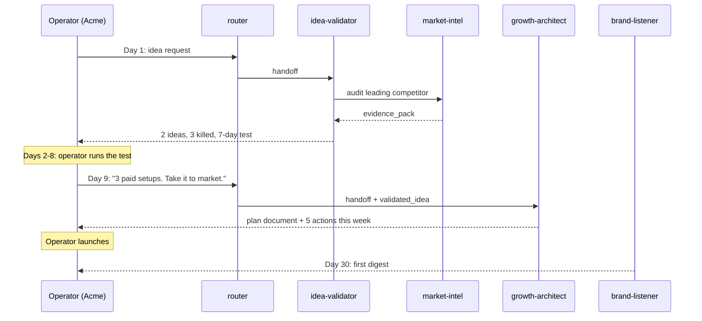

# End-to-end walkthrough: Acme Corp

> Entirely fictional. Acme Corp, Brightline Clinic Software, every person and every number below are invented to show how the agents hand work to each other.

**Setup.** Acme Corp is a four-person automation studio. The founder (the operator) wants a second revenue line that can be tested in a week with under 500 of spend.



---

## Day 1: request

**Operator to router**

> Small dental and vet clinics around us all complain about no-shows. Anything we could sell them that isn't another software subscription they have to learn?

**Router to idea-validator**

```yaml
handoff:
  to: idea-validator
  request: "Small dental and vet clinics around us all complain about no-shows. Anything we could sell them that isn't another software subscription they have to learn?"
  known_context:
    - "Acme is a 4-person automation studio."
    - "Budget for a test: under 500."
  constraints:
    - "Testable in one week"
    - "Not a self-serve SaaS the clinic must learn"
  reply_to: operator
```

**Router to operator:** "Passed to idea-validator."

## Day 1: evidence

idea-validator asks market-intel to audit the most visible competitor in no-show reduction for small clinics.

**market-intel evidence_pack (excerpt)**

```yaml
evidence_pack:
  brand: "Brightline Clinic Software"
  purpose: competitor
  findings:
    - claim: "14 active paid-social ads, all lead with free migration"
      tag: FACT
      source: "ad library search"
      accessed: "2026-03-04"
      screenshot: "paid_social-library_14-active_2026-03-04.png"
    - claim: "Every public case study is a group with 10+ locations"
      tag: FACT
      source: "brightline-clinic.example/customers"
      accessed: "2026-03-04"
      screenshot: "web_case-studies_2026-03-04.png"
    - claim: "Single-location clinics are under-served by their messaging"
      tag: INFERENCE
      source: "derived from the two findings above"
      accessed: "2026-03-04"
      screenshot: null
  not_found: ["pricing (behind demo form)", "video channel"]
```

## Day 1: ideas

**idea-validator to operator (chat, short)**

> Top idea: **no-show recovery, done for you**: we connect to the clinic's existing calendar export, send reminders and same-day rebook offers by message, and report recovered appointments weekly. Setup 300 + 79/month `[ASSUMPTION]`. Viability 7/10.
> Killed: AI phone receptionist (setup too long, voice quality risk), review automation (crowded), patient FAQ chatbot (regulated advice risk).
> 7-day test: visit 15 single-location clinics with a one-page before/after. **Success = 3 paid setups. Under 2 = kill.**

## Days 2 to 8: the operator runs the test

The agents do nothing here. The operator walks into clinics. Result: 15 visits, 6 interested, **3 paid setups**.

## Day 9: go-to-market

**Operator to router:** "3 paid setups. Take it to market."

The router forwards the `validated_idea`, now updated with the experiment result:

```yaml
validated_idea:
  name: "Acme Recover"
  customer: "Single-location dental and vet clinics, 1-4 practitioners"
  pain: "Empty slots from no-shows; front desk has no time to chase"
  offer: "Done-for-you reminders + same-day rebook offers + weekly recovered-revenue report"
  price_model: "Setup 300 + 79/month"
  first_10_customers_channel: "In-person visits within 30 minutes"
  viability_score: 8
  experiment_7d:
    action: "15 clinic visits with one-pager"
    success_metric: "3 paid setups"
    result: "3 paid setups from 15 visits"
  assumptions:
    - "[ASSUMPTION] Price holds above 15 customers"
```

growth-architect has no critical gaps (market, ticket and budget are all in the block), so it skips intake.

**growth-architect to operator (chat)**

> Verdict: real wedge, ceiling depends on how fast you can do setups. Promise: "Fill the slots no-shows leave empty."
> Launch first: local partnerships with two dental supply reps + a city-specific landing. Paid search only after 10 customers.
> Plan: `Acme Recover - GTM prototype` (document link)

**From the plan document (excerpts)**

Value proposition:
> For single-location clinics who lose slots to no-shows, Acme Recover is a done-for-you recovery service that refills empty appointments the same day, unlike practice software add-ons which the front desk has to configure and run.

Unit economics:

| Metric | Value |
|---|---|
| Gross margin | `[ESTIMATE]` 75 to 85%, messaging costs per clinic from published platform rates |
| Max tolerable CAC | `[ESTIMATE]` 250 to 350, 4-month payback on 79/month |
| Target LTV | `[ESTIMATE]` 1,400 to 1,900, assuming 18 to 24 months retention `[ASSUMPTION]` |

Landing hero (variant A):
> **H1:** Fill the slots no-shows leave empty.
> **Sub:** We set up reminders and same-day rebooking on your current calendar. No new software for your front desk.
> **CTA:** See how many slots you lost last month
> **Proof:** `[REAL SOCIAL PROOF REQUIRED]`: ask the 3 pilot clinics for a one-line quote and their recovered-appointment count after 30 days.

What I would do first this week:
1. Ask the 3 pilot clinics for permission to quote them after 30 days.
2. Book coffees with two dental supply reps who visit 40+ clinics a month.
3. Publish the city landing with the "lost slots" calculator.
4. Set up recovered-appointment tracking per clinic (it is the product's proof).
5. Write the 3-email nurture for clinics that use the calculator but do not book.

## Day 30: listening

The operator adds "Acme Recover" and the domain to brand-listener's watch list.

**brand-listener digest**

```
Acme Recover mentions, Thursday

1. [Buying intent] Regional dental forum, 23 replies
   "Is anyone using that Acme no-show thing? Worth it?" - link
   Why: a pilot clinic replied positively; 2 others asked for price. [FACT]
```

The operator replies on the forum personally. No agent touches it.

---

## What to notice

- **Every hand-off is a structured block.** No context is lost between agents.
- **The agents stop when a human must act.** Days 2 to 8 and every send are the operator's.
- **Every number is tagged.** The plan is reviewable: anyone can see which figures are observed and which are guesses.
- **Killed ideas are visible.** The operator sees what was rejected and why, not just the winner.
